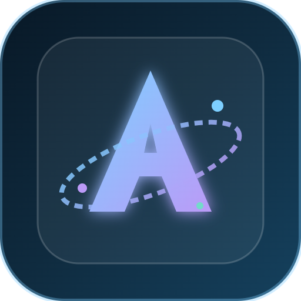

# Antigravity Theme Studio 🎨✨

<p align="center">
  
</p>

<p align="center">
  <strong>Ứng dụng Desktop độc lập (Standalone Electron App) tùy biến toàn diện giao diện Google Antigravity Desktop.</strong>
</p>

<p align="center">
  <a href="https://github.com/VuaThiLaiVaoE10/antigravity-theme/releases"></a>
  
  
  <a href="LICENSE"></a>
</p>

---

## 🌟 Tính Năng Nổi Bật

- 🌌 **Tùy biến hình nền (Custom Wallpaper)**: Tải ảnh bất kỳ từ máy tính (`.png`, `.jpg`, `.webp`, `.gif`) hoặc chọn nhanh từ các preset có sẵn (Cô gái kéo đàn, Cosmic Nebula, Cyberpunk Tokyo, Sakura Dusk).
- 🪟 **Hiệu ứng kính mờ (Frosted Glassmorphism)**: Tự do điều chỉnh độ mờ hậu cảnh (Backdrop Blur), độ trong suốt thanh Sidebar, thẻ Card và hộp thoại theo thời gian thực.
- 🎨 **Bảng màu & Gradient thời gian thực**: Cung cấp sẵn 6 bảng màu phong cách (Midnight Aqua, Kanagawa Wave, Kanagawa Dragon, Sakura Dusk, Tokyo Night, Nordic Frost) cùng khả năng chỉnh từng mã màu chữ, viền và gradient bong bóng chat.
- ⚡ **Zero-Restart Live Sync**: Tự động nhận diện cổng kết nối nội bộ của Antigravity và đồng bộ giao diện trong **0.01 giây** khi nhấn **Lưu & Chạy** mà không cần khởi động lại ứng dụng.
- 🛡️ **100% An Toàn & Độc Lập**: Hoàn toàn độc lập, không cần qua VS Code hay extension bên thứ ba. Tự động sao lưu an toàn và có nút khôi phục 1-click về nguyên bản gốc của Google.

---

## 🚀 Tải Về & Khởi Chạy

### Cách 1: Tải Bản Chạy Ngay (.exe Portable) — Khuyên Dùng
1. Truy cập mục **[Releases](https://github.com/VuaThiLaiVaoE10/antigravity-theme/releases)** của repository.
2. Tải về file `Antigravity-Theme-Studio-Portable-1.0.0.exe`.
3. Nhấp đúp chuột để mở và sử dụng ngay mà không cần cài đặt thêm bất kỳ phần mềm nào!

---

### Cách 2: Khởi Chạy Từ Mã Nguồn (Dành cho Developer)

```bash
# 1. Clone repository về máy
git clone https://github.com/VuaThiLaiVaoE10/antigravity-theme.git
cd antigravity-theme

# 2. Cài đặt thư viện phụ thuộc (chỉ cần chạy lần đầu)
npm install

# 3. Khởi chạy ứng dụng
npm start
# Hoặc nhấp đúp trực tiếp vào file run.bat
```

---

## 🛠️ Đóng Gói Thành File .exe (Build Executable)

Nếu bạn muốn tự đóng gói mã nguồn thành file cài đặt Windows `.exe`:
```bash
# Đóng gói bản Portable chạy ngay
npm run dist:portable

# Hoặc nhấp đúp vào file build-exe.bat
```
File thực thi `.exe` sau khi đóng gói sẽ nằm tại thư mục `dist/`.

---

## 📂 Cấu Trúc Thư Mục Dự Án

```plaintext
antigravity-theme/
├── .github/
│   └── workflows/
│       └── release.yml          # GitHub Actions tự động build file .exe khi có Release
├── assets/
│   ├── icon.ico                 # Icon ứng dụng Windows
│   ├── icon.png                 # Icon chuẩn 512x512
│   ├── icon.svg                 # Vector source icon
│   └── violinist-earth.jpg      # Hình nền mẫu mặc định
├── renderer/                    # Giao diện Theme Studio & Live Preview
│   ├── app.js                   # Logic điều khiển, i18n, live preview 60 FPS
│   ├── index.html               # Cấu trúc giao diện 5 tab
│   └── style.css                # CSS thiết kế kính mờ Glassmorphism
├── liveSync.js                  # Engine kết nối CDP đồng bộ tức thì sang Antigravity
├── main.js                      # Electron main process & IPC handlers
├── palettes.js                  # 6 bảng màu nghệ thuật cùng hệ thống token màu
├── patcher.js                   # Module sao lưu & can thiệp app.asar an toàn
├── preload.js                   # Cầu nối IPC contextBridge bảo mật
├── build-exe.bat                # Script 1-click đóng gói file .exe trên máy
├── run.bat                      # Script 1-click khởi chạy app trên Windows
├── package.json                 # Cấu hình electron-builder & scripts
├── LICENSE                      # Giấy phép nguồn mở MIT
└── README.md                    # Tài liệu hướng dẫn sử dụng
```

---

## 📖 Hướng Dẫn Sử Dụng Chi Tiết

1. **Chọn ảnh nền (Tab Hình nền)**:
   - Nhấn **"Chọn ảnh từ máy tính..."** để chọn file ảnh yêu thích.
   - Kéo thanh trượt **Độ hiển thị ảnh nền** để cân bằng độ sáng tối theo mắt nhìn.
2. **Chọn màu & Gradient (Tab Màu & Avatar)**:
   - Chọn nhanh các bảng màu phối sẵn như **Midnight Aqua**, **Tokyo Night**, **Kanagawa**.
   - Tùy chỉnh màu viền và nền gradient của khung nhập chat.
3. **Chỉnh độ mờ kính (Tab Kính & Mờ)**:
   - Tinh chỉnh **Độ mờ hậu cảnh (Backdrop Blur)** và **Độ mờ thanh Sidebar**.
4. **Áp dụng (Save & Apply)**:
   - Nhấn nút **"Lưu & Chạy"** ở góc trên bên phải. Cửa sổ Antigravity sẽ chuyển theme ngay lập tức!
5. **Khôi phục nguyên bản (Tab Nâng cao)**:
   - Khi muốn hoàn trả Antigravity về giao diện gốc của Google, chỉ cần vào tab **Nâng cao** và bấm nút **"Khôi phục Antigravity nguyên bản"**.

---

## 📄 Giấy Phép & Bản Quyền
Phát hành theo giấy phép nguồn mở **MIT License**. Bạn được toàn quyền sử dụng, sửa đổi và phân phối miễn phí.
